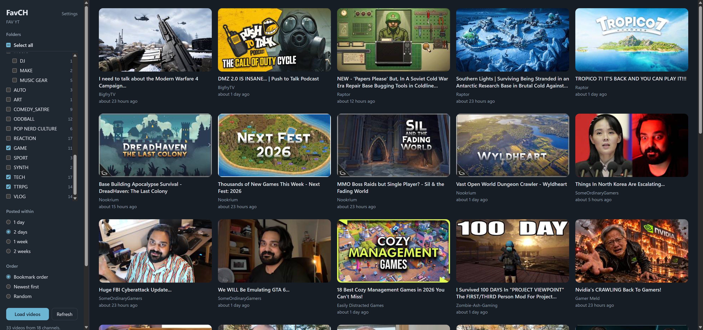

# FavCH (Favorite Channels)

A home page built only from the YouTube channels you choose. No recommendations, no Shorts, no livestreams. Just the new videos from channels you've bookmarked, in the order you keep them.

## How it works

1. Make a bookmark folder for your favorite channels, with subfolders for groups if you like (for example "History", "Woodworking", "Music").
2. Bookmark each channel's page, or any one of its videos, into those folders.
3. Click the FavCH icon. Tick the groups you want, choose how far back to look (1 day to 2 weeks), and choose the order: bookmark order, newest first, or random.
4. Click a video to watch it on YouTube.

FavCH remembers your last choices. Settings has light and dark themes and a muted-words list for hiding videos by title.

## Install

**From the Chrome Web Store:** link coming soon. Works in Chrome, Brave, Edge, Vivaldi, and Opera.

**Manually:**
1. Download `favch.zip` from the [latest release](../../releases/latest) and unzip it somewhere permanent, such as Documents. FavCH stops working if this folder is moved or deleted.
2. Open your browser's extensions page (`chrome://extensions`, `brave://extensions`, or `edge://extensions`) and turn on Developer mode.
3. Click **Load unpacked** and choose the `favch` folder, the one with `manifest.json` directly inside it. Windows' "Extract All" often puts it one level deeper than you expect (`favch\favch`).
4. Settings opens automatically. Choose your channels folder.

To update, replace the files in that folder with the new release, then click the reload arrow on FavCH's card on the extensions page.

## Your data

FavCH has no servers, accounts, or tracking. Your bookmarks and settings stay in your browser. The only network requests it makes are to YouTube, to check your channels for new videos.

## Known limits

- Each channel's public feed lists its 15 most recent regular uploads, so a channel posting more than that within your time frame will be cut short.
- Shorts and livestreams are filtered out using YouTube's own categories. A stream recording that a creator reuploads as a regular video will still appear.
- YouTube's feed server has bad stretches. When a feed doesn't answer, FavCH reads the channel's Videos page instead (upload times are then approximate), or shows the last results it saved. If nothing answers, wait an hour or so; reloading over and over makes YouTube refuse requests for longer.
- If YouTube changes how its pages or feeds work, lookups can break until FavCH is updated. Check this repository for new versions.
